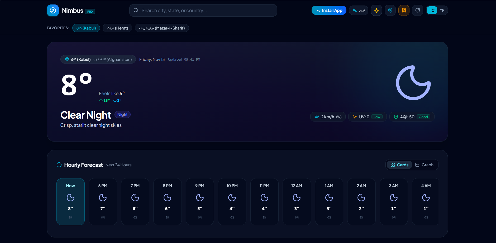
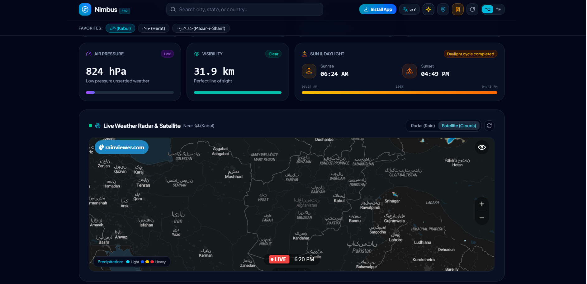

# Nimbus Weather 🌦️

A modern, responsive weather application with **English and Dari
(Persian)** language support. Nimbus Weather provides current weather
conditions, hourly and 7-day forecasts, air-quality information, and
interactive rain radar --- all in a clean dashboard designed for desktop
and mobile devices.

**Created by:** DevShabir

------------------------------------------------------------------------

## 📸 Screenshots

### Weather Dashboard

The main dashboard displays the selected location, current temperature,
feels-like temperature, daily high and low, weather condition, and quick
weather indicators. The hourly forecast is available in card and graph
views.



### Weather Details and Live Radar

Additional information includes atmospheric pressure, visibility,
sunrise and sunset times, and an interactive map with rain-radar and
satellite-cloud layers.



------------------------------------------------------------------------

## ✨ Features

### Current Weather

-   Current temperature and weather condition
-   Feels-like temperature
-   Daily high and low temperatures
-   Weather condition description
-   Wind speed and direction
-   UV index
-   Air Quality Index (AQI), when data is available

### Forecasts

-   Hourly forecast for the next 24 hours
-   7-day weather forecast
-   Hourly forecast displayed as cards or a graph
-   Precipitation probability

### Weather Details

-   Atmospheric pressure
-   Visibility distance
-   Sunrise and sunset times
-   Daylight progress indicator
-   Wind, UV, and air-quality summary indicators

### Interactive Weather Radar

-   Live precipitation radar
-   Satellite cloud layer
-   Map zoom controls
-   Radar refresh control
-   Map focused on the selected location

### Locations and Search

-   Search for cities, states, and countries
-   Save favorite locations for quick access
-   Quick access to saved cities
-   Use the device's current location through GPS permission

### User Interface

-   English and Dari language support
-   Right-to-left (RTL) layout for Dari
-   Light and dark themes
-   Celsius and Fahrenheit temperature units
-   Responsive layout for desktop, tablet, and mobile
-   Weather icons and subtle interface animations

### Progressive Web App

-   Installable as a Progressive Web App (PWA)
-   Offline support for cached app resources and previously available
    content
-   App-like experience on supported devices

------------------------------------------------------------------------

## 🧰 Tech Stack

  Technology     Purpose
  -------------- --------------------------------------
  React          User interface
  TypeScript     Type-safe application development
  Vite           Development server and build tool
  Tailwind CSS   Styling and responsive layouts
  Motion         UI animations and transitions
  Lucide         Interface icons
  Vite PWA       PWA installation and offline caching

------------------------------------------------------------------------

## 🌐 Data Sources

-   **[Open-Meteo](https://open-meteo.com/)** --- weather conditions,
    forecasts, and related meteorological data.
-   **[RainViewer](https://www.rainviewer.com/)** --- precipitation
    radar imagery.

The current project configuration does not require an API key for these
services. Please review each provider's terms, attribution requirements,
and usage limits before deploying the application publicly.

------------------------------------------------------------------------

## 📋 Requirements

Make sure the following tools are installed:

-   [Node.js](https://nodejs.org/) **18 or later**
-   npm
-   Git (optional, but recommended)

------------------------------------------------------------------------

## 🚀 Getting Started

### 1. Clone the repository

``` bash
git clone https://github.com/DevShabir/<repository-name>.git
cd <repository-name>
```

Replace `<repository-name>` with the actual GitHub repository name.

### 2. Install dependencies

``` bash
npm ci
```

If the project does not include a `package-lock.json` file, use:

``` bash
npm install
```

### 3. Start the development server

``` bash
npm run dev
```

Open the local URL printed in your terminal. In the current project
configuration, the default address is:

``` text
http://localhost:3000
```

------------------------------------------------------------------------

## 🏗️ Lint, Build, and Preview

### Run lint checks

``` bash
npm run lint
```

### Build for production

``` bash
npm run build
```

The production-ready files will be generated in the `dist/` directory.

### Preview the production build

``` bash
npm run preview
```

Vite will print the local preview address in the terminal.

------------------------------------------------------------------------

## ☁️ Deploying to GitHub

1.  Create a new repository on GitHub.
2.  Open a terminal in the project directory.
3.  Run the following commands:

``` bash
git init
git add .
git commit -m "Initial release"
git branch -M main
git remote add origin https://github.com/DevShabir/<repository-name>.git
git push -u origin main
```

Replace `<repository-name>` with your repository name.

### GitHub Actions

The project includes a GitHub Actions workflow that runs the configured
checks, including type checking and the production build, on pushes and
pull requests.

------------------------------------------------------------------------

## 📁 Project Structure

The exact structure may vary depending on the current implementation. A
typical Vite project structure looks like this:

``` text
nimbus-weather/
├── public/                 # Static public assets
├── src/                    # Application source code
│   ├── components/         # Reusable UI components
│   ├── ...                 # Pages, hooks, services, and utilities
├── docs/
│   └── images/
│       ├── nimbus-dashboard.png
│       └── nimbus-radar.png
├── index.html
├── package.json
├── package-lock.json
└── vite.config.ts
```

------------------------------------------------------------------------

## 🔒 Location and Privacy

-   Browser location access requires the user's permission.
-   If permission is not granted, users can search for a location
    manually.
-   Weather and radar information is retrieved from external data
    providers.
-   Review the privacy policies and terms of the relevant providers when
    deploying the application.

------------------------------------------------------------------------

## ⚠️ Notes

-   An internet connection is required to retrieve current weather,
    forecast, and live radar data.
-   Offline mode does not guarantee that live weather or radar data will
    be available. It is intended for cached application resources and
    supported previously loaded content.
-   PWA installation availability depends on the browser and hosting
    environment. HTTPS is generally required; `localhost` is supported
    for development.
-   Weather values shown in screenshots are examples for the displayed
    location and time. Live values will change according to the selected
    location and data provider.
-   If a command fails, check your Node.js version and make sure
    dependencies were installed successfully.

------------------------------------------------------------------------

## 👨‍💻 Author

**DevShabir**

Built with ❤️ to make weather information clear, accessible, and easy to
explore.
